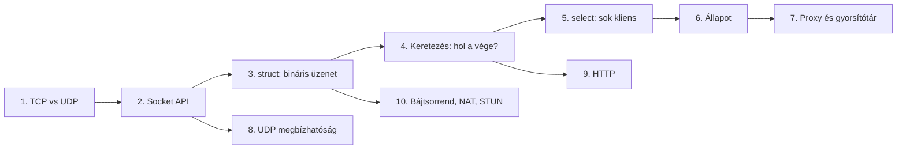
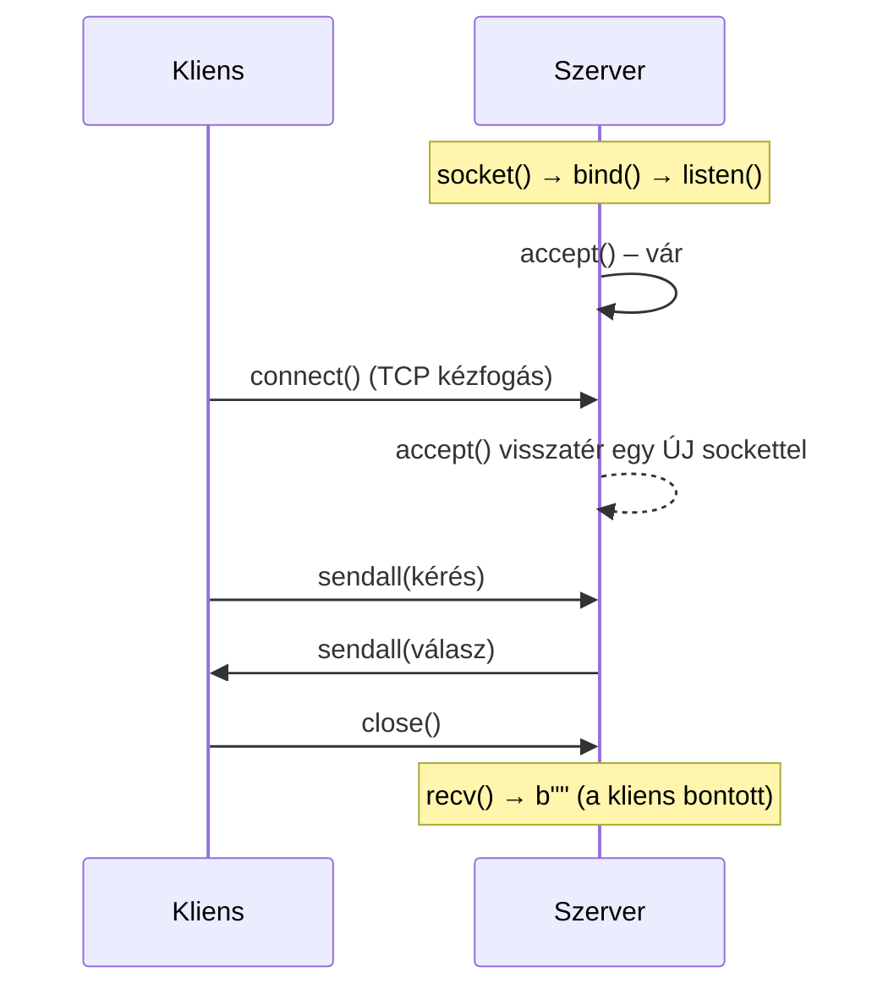
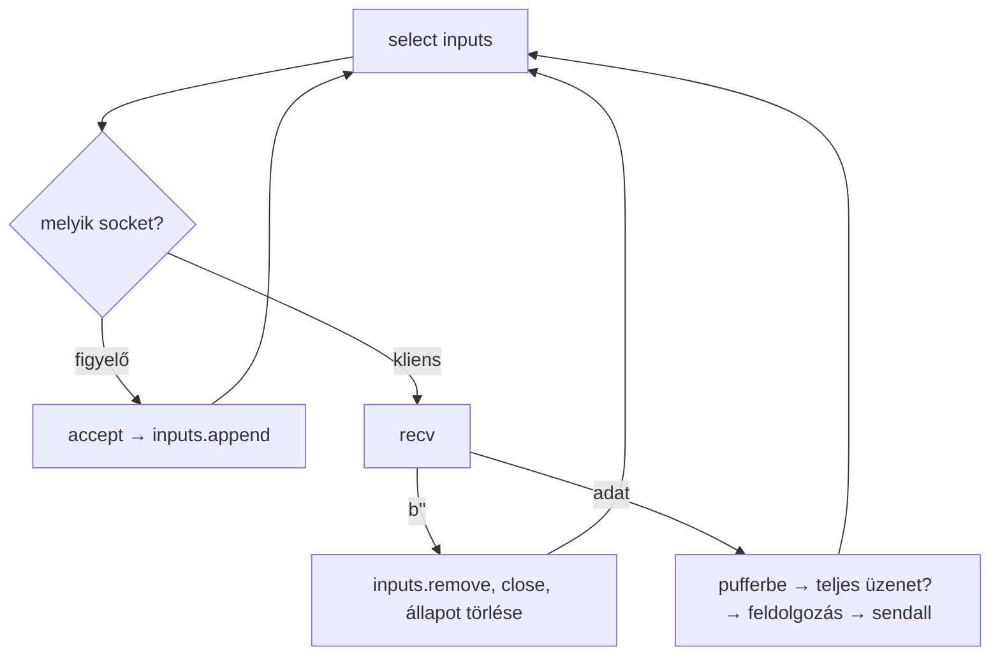
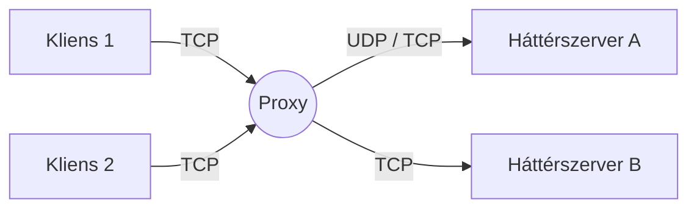
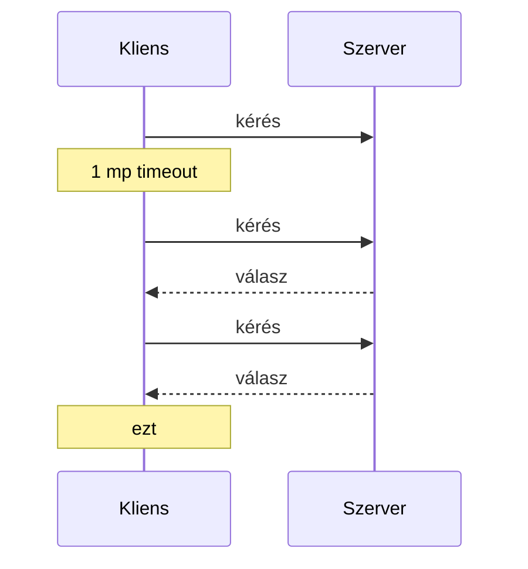
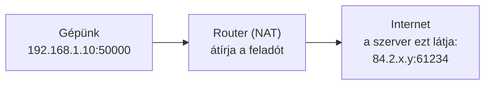

# Socket programozás Pythonban – elméleti jegyzet példákkal

> [!abstract] Mire jó ez a jegyzet
> Ez nem megoldásgyűjtemény. Azt a tudást rendezi egybe, amire a TCP/UDP kliensek és szerverek, a `select`-es többklienses szerverek, a proxyk, a gyorsítótár, a saját webszerver és a STUN kliens megírásához szükség van. A példák szándékosan **más témájúak**, mint a házi feladatok: a mintákat mutatják, nem a konkrét megoldást.
> Gyors puskához: [[2.ZH Cheatsheet]]



---

## 1. TCP és UDP – a két szállítási protokoll

Az alkalmazás nem közvetlenül a hálózattal beszél, hanem az operációs rendszer **socket** interfészével. A socket egy végpont, amelyet a `(IP-cím, port)` pár azonosít. Egy kapcsolatot vagy beszélgetést két ilyen pár ír le: a sajátunk és a túloldalé.

| Tulajdonság | TCP (`SOCK_STREAM`) | UDP (`SOCK_DGRAM`) |
|---|---|---|
| Kapcsolat | van (kézfogás, majd bontás) | nincs, minden csomag önálló |
| Adategység | **bájtfolyam** – nincsenek üzenethatárok | **datagram** – egy `sendto` = egy `recvfrom` |
| Megbízhatóság | sorrendhelyes, nem vész el, nem duplikálódik | elveszhet, duplikálódhat, felcserélődhet |
| Ki kivel beszél | a `connect`/`accept` után rögzített | minden csomagnál meg kell adni a címet |
| Tipikus használat | web, fájlátvitel, bármi, ahol minden byte kell | DNS, STUN, videóhívás, játékok |

> [!important] A két legfontosabb következmény
> - **TCP:** mivel bájtfolyam, *a vevő nem tudja, hol ér véget egy üzenet*. Ezt az alkalmazásnak kell megoldania (→ [[#4. Keretezés – hol ér véget egy üzenet?|4. fejezet]]).
> - **UDP:** mivel megbízhatatlan, *a küldőnek kell észrevennie, ha nem jött válasz*, és újra kell küldenie (→ [[#8. UDP megbízhatósága – időkorlát, újraküldés, sorszám|8. fejezet]]).

---

## 2. A socket API életciklusa

### 2.1 TCP



- A **szerver socket** (`listen`) csak kapcsolatokat fogad. Minden `accept()` egy **új socketet** ad, amelyen az adott klienssel beszélünk.
- A `recv(n)` **legfeljebb** `n` byte-ot ad vissza, lehet kevesebbet is. Ha `b""`-t ad, a túloldal bontott.
- `send` helyett `sendall`: a `send` nem garantálja, hogy mindent elküldött.

```python
import socket

# szerver váz
with socket.socket(socket.AF_INET, socket.SOCK_STREAM) as srv:
    srv.setsockopt(socket.SOL_SOCKET, socket.SO_REUSEADDR, 1)
    srv.bind(("", 12345))          # "" = minden interfész, "localhost" = csak helyi
    srv.listen()
    conn, cim = srv.accept()
    with conn:
        adat = conn.recv(1024)
        conn.sendall(adat.upper())

# kliens váz
with socket.socket(socket.AF_INET, socket.SOCK_STREAM) as s:
    s.connect(("localhost", 12345))
    s.sendall(b"hello")
    print(s.recv(1024))
```

> [!tip] `SO_REUSEADDR`
> Bontás után a port egy ideig `TIME_WAIT` állapotban marad. Az opció nélkül újraindításkor `OSError: Address already in use` hibát kapunk. Minden TCP szerverbe tedd bele.

### 2.2 UDP

```python
# szerver: nincs listen/accept – minden datagram a feladó címével érkezik
with socket.socket(socket.AF_INET, socket.SOCK_DGRAM) as s:
    s.bind(("localhost", 12346))
    adat, felado = s.recvfrom(1024)
    s.sendto(adat[::-1], felado)       # a válasz a feladó címére megy

# kliens: bind sem kell, az első sendto-nál kap egy véletlen helyi portot
with socket.socket(socket.AF_INET, socket.SOCK_DGRAM) as s:
    s.settimeout(1.0)
    s.sendto(b"abc", ("localhost", 12346))
    print(s.recvfrom(1024))            # (b'cba', ('127.0.0.1', 12346))
```

> [!note] UDP részletek
> - A szerver a `recvfrom`-ból tudja meg, kinek kell válaszolni. Ezért **egyetlen UDP socket** több klienst is kiszolgálhat, és nincs szükség `select`-re, `accept`-re.
> - Ha a `recvfrom` puffere kisebb a datagramnál, a maradék **elveszik**. Ez nem úgy működik, mint a TCP, ahol a maradék megmarad a következő `recv`-hez.
> - A kliens helyi portja minden socketnél más. Ezt később kihasználjuk (→ 8.3).

### 2.3 Parancssori paraméterek

Az ellenőrző programok a programot `python prog.py <arg1> <arg2>` formában indítják, **`input()` nélkül**:

```python
import sys
if len(sys.argv) != 3:
    sys.exit("Használat: python prog.py <host> <port>")   # kilépési kód 1, üzenet stderr-re
host, port = sys.argv[1], int(sys.argv[2])                # minden argv elem sztring!
```

### 2.4 Blokkoló hívások

Az `accept`, `recv`, `recvfrom` és `connect` hívás **blokkol**: addig nem tér vissza, amíg nincs mit visszaadni. Egy egyszerű szerver ezért egyszerre csak egy klienssel foglalkozik. A megoldás a `select` (→ 5. fejezet).
A `settimeout(t)` után a hívás legfeljebb `t` másodpercig vár, utána `TimeoutError` (`socket.timeout`) kivételt dob.

---

## 3. Bináris üzenetek a `struct` modullal

A hálózaton csak **byte-ok** mennek át. A `struct` Python értékeket (int, float, bytes) alakít fix szerkezetű byte-sorozattá, és vissza.

```python
import struct
uzenet = struct.Struct("3s i h")          # 3 byte szöveg, 4 byte int, 2 byte short
adat = uzenet.pack(b"abc", 1000, -2)       # bytes
kod, szam, kicsi = uzenet.unpack(adat)     # MINDIG tuple
uzenet.size                                # a teljes méret byte-ban
```

### 3.1 Formátumkarakterek

| Kód | Python típus | Méret | Megjegyzés |
|---|---|---|---|
| `c` | `bytes` (1 hosszú) | 1 | `b"+"` |
| `Ns` | `bytes` | N | rövidebbet `\x00`-val kitölti, hosszabbat levágja |
| `b` / `B` | int | 1 | előjeles / előjel nélküli |
| `h` / `H` | int | 2 | |
| `i` / `I` | int | 4 | |
| `q` / `Q` | int | 8 | |
| `f` / `d` | float | 4 / 8 | |
| `?` | bool | 1 | |

```python
struct.pack("4s", b"almafa")   # b'alma'           – levágta
struct.pack("4s", b"ab")       # b'ab\x00\x00'     – kitöltötte
b"ab\x00\x00".rstrip(b"\x00")  # b'ab'             – fogadáskor le kell vágni
```

### 3.2 `str` ↔ `bytes`

Az `s` mező **bytes**-t vár, nem sztringet:

```python
nev = "Éva"
adat = struct.pack("10s", nev.encode())            # str → bytes (UTF-8)
vissza = struct.unpack("10s", adat)[0].rstrip(b"\x00").decode()
```

> [!warning] Az ékezetes karakter több byte
> `len("Éva") == 3`, de `len("Éva".encode()) == 4`. Ha a mező 3 byte-os, UTF-8 karakter közepén vághatja el.

### 3.3 Bájtsorrend és igazítás – a leggyakoribb meglepetés

A formátum első karaktere dönti el, hogyan rendeződnek a byte-ok:

| Előtag | Bájtsorrend | Igazítás (padding) |
|---|---|---|
| *(nincs)* vagy `@` | a gépé (x86/ARM: little-endian) | **natív**: van kitöltés |
| `=` | a gépé | nincs |
| `<` | little-endian | nincs |
| `>` vagy `!` | big-endian = **hálózati bájtsorrend** | nincs |

**Natív igazítás:** egy `i` mező csak 4-gyel osztható pozíción kezdődhet, ezért elé kitöltő byte-ok kerülnek.

| Formátum | Mezők összege | `calcsize` | Miért |
|---|---|---|---|
| `"i i c"` | 9 | **9** | a `c` a végén van, utána nincs igazítás |
| `"i c"` | 5 | **5** | |
| `"c i"` | 5 | **8** | `c` + 3 kitöltő + `i` |
| `"i c i"` | 9 | **12** | a második `i` előtt 3 kitöltő |
| `"2s i i"` | 10 | **12** | `2s` + 2 kitöltő |
| `"5s i"` | 9 | **12** | `5s` + 3 kitöltő |
| `"=5s i"` / `"!5s i"` | 9 | **9** | nincs igazítás |

```python
struct.pack("2s i i", b"OK", 4711, 100).hex(" ")
# '4f 4b 00 00 67 12 00 00 64 00 00 00'
#  O  K  ^^^^^ kitöltés   4711 LE      100 LE
```

> [!important] Szabály
> Ha a két oldal **ugyanazt a formátumsztringet** használja, a kitöltés nem okoz gondot. A méretet viszont soha ne számold fejben: `recv`-nél mindig `packer.size` vagy `struct.calcsize(...)` kell.
> Idegen protokollnál (STUN, DNS stb.) **mindig `!`** kell: a hálózati szabványok big-endian sorrendet írnak elő, kitöltés nélkül.

### 3.4 Részleges kicsomagolás: `unpack_from`

Ha egy hosszabb üzenetben egy adott pozíción lévő mezőt akarunk olvasni, nem kell szeletelni:

```python
fejlec = struct.Struct("!HH")
tipus, hossz = fejlec.unpack_from(adat, offset)    # adat[offset:offset+4]-ből olvas
```

### 3.5 Mit jelent, ha rossz formátummal olvasunk?

A `struct` nem ellenőriz semmit, bármilyen byte-ot kicsomagol. Ha egy böngésző HTTP kérése egy `"4s i"`-t váró szerverhez fut be:

```python
struct.unpack("4s i", b"GET /ind")    # (b'GET ', 1684957487)
```

A „szám” valójában a `/ind` szöveg 4 byte-ja egészként olvasva. **Ha a naplóban értelmetlen, óriási számokat és szövegdarabokat látsz, protokoll-eltérés van**: rossz program csatlakozott, rossz a formátum, vagy elcsúszott az üzenethatár.

---

## 4. Keretezés – hol ér véget egy üzenet?

A TCP bájtfolyam: a küldő `sendall` hívásai és a vevő `recv` eredményei **nem feleltethetők meg egymásnak**.

```text
Küldő:   sendall(A1 A2 A3 A4)      sendall(B1 B2 B3 B4)
Hálózat: ───────────────────────────────────────────────
Vevő:    recv → A1 A2   recv → A3 A4 B1   recv → B2 B3 B4
```

Egy `recv` tehát adhat **fél üzenetet** (lassú kliens, darabolt küldés), és adhat **másfél üzenetet** (két gyors kérés egybefolyik). Az üzenethatárt háromféleképpen lehet jelölni.

### 4.1 Fix méretű üzenet → `recv_exact`

Ha minden üzenet pontosan `n` byte (pl. egy `struct` formátum), addig olvasunk, amíg meg nem lesz:

```python
def recv_exact(sock, n):
    adat = b""
    while len(adat) < n:
        darab = sock.recv(n - len(adat))   # csak annyit kérünk, amennyi hiányzik
        if not darab:
            return b""                     # bontott közben
        adat += darab
    return adat
```

> [!tip] Miért `n - len(adat)`?
> Így soha nem olvasunk bele a következő üzenetbe: ami a következőhöz tartozik, az a kernelben marad a következő `recv`-ig.

### 4.2 Elválasztó jel (szöveges protokollok)

A sor alapú protokollok `\n`-nel, a HTTP fejléce `\r\n\r\n`-nel jelzi az üzenet végét. Gyűjtünk, és amíg van elválasztó a pufferben, kivágjuk:

```python
def sorok_kivetele(puffer):
    sorok = []
    while b"\n" in puffer:
        sor, puffer = puffer.split(b"\n", 1)
        sorok.append(sor)
    return sorok, puffer               # a maradék egy félbe maradt sor eleje

sorok_kivetele(b"egy\nket")            # ([b'egy'], b'ket')
```

### 4.3 Hossz-előtag

Az üzenet elé írjuk a hosszát. Így tetszőleges (bináris) tartalom is átvihető, és a vevő pontosan tudja, mennyit kell várnia. A STUN is így működik: a fejléc tartalmazza a törzs hosszát.

```python
fejlec = struct.Struct("!H")
def keretez(adat):
    return fejlec.pack(len(adat)) + adat

def keret_kivetele(puffer):
    if len(puffer) < fejlec.size:
        return None, puffer                        # még a hossz sincs meg
    (n,) = fejlec.unpack_from(puffer)
    if len(puffer) < fejlec.size + n:
        return None, puffer                        # a törzs még nincs meg
    return puffer[fejlec.size:fejlec.size + n], puffer[fejlec.size + n:]
```

| Módszer | Előny | Hátrány | Példa |
|---|---|---|---|
| Fix méret | egyszerű | nem rugalmas | `struct` alapú parancsok |
| Elválasztó | ember által olvasható | az elválasztó nem fordulhat elő a tartalomban | HTTP fejléc, SMTP, Redis |
| Hossz-előtag | bármilyen tartalom | kétlépcsős olvasás | STUN, TLS rekordok, HTTP `Content-Length` |

---

## 5. Több kliens egyszerre: `select`

### 5.1 Az alapötlet

Egy szál, egy ciklus. A `select` megmondja, **melyik socketen van teendő**, így blokkoló hívást csak ott teszünk, ahol azonnal visszatér.

```python
olvashato, irhato, hibas = select.select(figyelt_olvasasra, figyelt_irasra, [], timeout)
```

Egy socket akkor „olvasható”, ha:

| Socket | Olvasható, ha… | Teendő |
|---|---|---|
| figyelő (listen) socket | új kliens vár | `accept()` → az új socketet felvesszük a listára |
| kliens socket | jött adat **vagy** a kliens bontott | `recv()`; ha `b""`: levesszük a listáról és lezárjuk |
| UDP socket | jött egy datagram | `recvfrom()` |

A `timeout` (pl. `1.0`) miatt a ciklus akkor is megfordul, ha semmi sem történik. Ez jól jön időzítéshez, és ahhoz, hogy a Ctrl+C Windowson is működjön.



### 5.2 Teljes példa: sor alapú „jegyzettömb” szerver

A protokoll szöveges, soronként egy parancs: `PUT kulcs érték`, `GET kulcs`, `COUNT`. A példa a fejezet összes elemét tartalmazza: kliensenkénti puffer, közös és kliensenkénti állapot, takarítás bontáskor.

```python
import select, socket

srv = socket.socket()
srv.setsockopt(socket.SOL_SOCKET, socket.SO_REUSEADDR, 1)
srv.bind(("localhost", 12347)); srv.listen()

inputs = [srv]
pufferek = {}       # kliens socket -> félig beérkezett adat
uzenetszam = {}     # kliens socket -> hány parancsot küldött (KLIENSENKÉNTI állapot)
jegyzetek = {}      # kulcs -> érték (KÖZÖS állapot, mindenki ugyanazt látja)

while True:
    olvashato, _, _ = select.select(inputs, [], [], 1.0)
    for s in olvashato:
        if s is srv:
            c, _ = srv.accept()
            inputs.append(c); pufferek[c] = b""; uzenetszam[c] = 0
            continue
        adat = s.recv(1024)
        if not adat:                                   # bontás: takarítás
            inputs.remove(s); del pufferek[s]; del uzenetszam[s]; s.close()
            continue
        sorok, pufferek[s] = sorok_kivetele(pufferek[s] + adat)
        for sor in sorok:                              # 0, 1 vagy több teljes parancs
            uzenetszam[s] += 1
            parancs, *resz = sor.decode().split()
            if parancs == "PUT" and len(resz) == 2:
                jegyzetek[resz[0]] = resz[1]; valasz = "OK"
            elif parancs == "GET" and len(resz) == 1:
                valasz = jegyzetek.get(resz[0], "-")
            elif parancs == "COUNT":
                valasz = str(uzenetszam[s])
            else:
                valasz = "ERR"
            s.sendall((valasz + "\n").encode())
```

Kipróbálva: a félbe küldött `GET al` + `ma\n` helyes választ kap. Az egy csomagban érkező `PUT x 1\nGET x\n` két választ kap. Egy kliens bontása után a másik kliens továbbra is látja a jegyzeteket.

### 5.3 `recv_exact` a `select` mellett – a csapda

A blokkoló `recv_exact`-ot **könnyű** betenni a `select` ciklusba, de van ára:

```python
msg = recv_exact(s, packer.size)   # ha a kliens 3 byte után 2 mp-et vár…
```

…akkor ez a hívás 2 másodpercig blokkol, és **a teljes szerver áll**: a többi kliens sem kap választ. Ez a legtöbb ellenőrző tesztnél elfogadható, de a helyes megoldás a **kliensenkénti puffer**:

```python
adat = s.recv(packer.size - len(pufferek[s]))   # csak ami hiányzik
pufferek[s] += adat
if len(pufferek[s]) < packer.size:
    continue                                    # még nincs meg – megyünk tovább
uzenet, pufferek[s] = pufferek[s], b""
```

| | blokkoló `recv_exact` | kliensenkénti puffer |
|---|---|---|
| Kód | rövidebb | pár sorral hosszabb |
| Lassú kliens | **megállítja** a szervert | csak magát késlelteti |
| Mikor jó | gyakorlás, megbízható kliensek | valódi többklienses szerver |

### 5.4 Más kiszolgálási modellek (kitekintés)

| Modell | Hogyan | Pro / kontra |
|---|---|---|
| Iteratív | egyszerre egy kliens | egyszerű, de nem skálázódik |
| Szálanként egy kliens | `threading.Thread` minden `accept` után | egyszerű kód, de a közös állapothoz zár (lock) kell |
| `select` / eseményhurok | egy szál, több socket | nincs versenyhelyzet, de nem szabad blokkolni |
| `asyncio` | `select` + korutinok | a modern Python-megoldás, ugyanez az elv |

---

## 6. Állapotkezelés a szerveren

### 6.1 Közös és kliensenkénti állapot

| | Kulcs | Élettartam | Példa |
|---|---|---|---|
| **Közös** | tartalom szerint (név, azonosító, kód) | a szerver futásáig | raktárkészlet, jegyzetek, számlák |
| **Kliensenkénti** | a kliens **socketje** | a kapcsolat végéig | puffer, „bejelentkezett-e”, ki mit tett |

```python
foglalasok = {}        # kliens socket -> lefoglalt hely (kliensenkénti)
szabad_helyek = 10     # közös

def bont(sock):
    inputs.remove(sock)
    foglalasok.pop(sock, None)      # a kapcsolathoz kötött adat megszűnik…
    sock.close()                    # …a közös állapotról a feladat dönt
```

> [!question] Tervezési kérdés: mi történjen bontáskor?
> Megmaradjon a kliens hatása (pl. egy leadott szavazat), vagy vonódjon vissza (pl. egy foglalás felszabaduljon)? Ezt mindig a specifikáció dönti el. A socket mint kulcs bontás után **mindenképp** törlendő, különben a szótár a lezárt socketekre mutató bejegyzésekkel telik meg.

### 6.2 Hibás kérések kezelése

Három bevett megoldás, a protokoll írja elő, melyik kell:

1. **Hibakód a válaszban** (pl. `-1`, `-2`, HTTP `404`). Akkor jó, ha a kérés formailag rendben van, csak tartalmilag hibás.
2. **A kapcsolat bontása, válasz nélkül.** Akkor jó, ha a kérés értelmezhetetlen, és nem bízhatunk benne, hogy az üzenethatárok még a helyükön vannak.
3. **Eldobás, válasz nélkül.** UDP-nél ez a szokásos: a kliens időkorlátja kezeli.

```python
if parancs not in ISMERT_PARANCSOK:
    bont(s)          # 2. eset: nincs sendall, csak bontás
    continue
```

> [!warning] Ne hagyd, hogy egy kliens leállítsa a szervert
> Ha a kliens hirtelen bont, a `recv` vagy a `sendall` `ConnectionResetError` kivételt dobhat. Kezeld le, és kezeld bontásként:
> ```python
> try:
>     adat = s.recv(n)
> except ConnectionError:
>     adat = b""
> ```

---

## 7. Proxy, átjáró, gyorsítótár

### 7.1 Mi a proxy?

A proxy a kliensek felé **szerver**, a háttérszerver felé **kliens**. A kettő között továbbít, és közben átalakíthat:



| Feladat | Mit csinál a proxy | Valós példa |
|---|---|---|
| Átlátszó továbbítás | változtatás nélkül küldi át a byte-okat | TCP proxy, port forwarding |
| Protokoll-fordítás | TCP ↔ UDP, más formátum, más parancsnevek | API gateway |
| Elosztás (routing) | a kérés tartalma alapján választ háttérszervert | reverse proxy (nginx), load balancer |
| Gyorsítótár | a már ismert választ maga adja | CDN, HTTP cache, DNS resolver |

### 7.2 Állandó háttérkapcsolat

Ha minden kéréshez új TCP kapcsolatot nyitnánk a háttérszerverhez, minden kérés fizetne egy kézfogást. Ezért a proxy **induláskor egyszer** csatlakozik, és minden kérést ezen küld. Ehhez a háttérszervernek is egy kapcsolaton több kérést kell tudnia kiszolgálni.

```python
import socket, time
def csatlakozik(cim, probak=50):
    for _ in range(probak):                 # ha a háttérszerver még indul, várunk rá
        try:
            return socket.create_connection(cim)
        except ConnectionRefusedError:
            time.sleep(0.1)
    raise SystemExit(f"Nem elérhető: {cim}")
```

### 7.3 Két stílus: megvárjuk a háttérszervert, vagy nem?

**a) Blokkolva.** Elküldjük a kérést, és a választ azonnal, `recv_exact`-tal megvárjuk. Egyszerű, de amíg a háttérszerver gondolkodik, a proxy semmi mást nem csinál.

**b) A háttér-socket is a `select`-ben.** A kérés elküldése után visszatérünk a ciklusba. Ha a háttér-socket olvasható lesz, a válasz megérkezett, és továbbítjuk annak, aki várja.
Honnan tudjuk, kié a válasz? Ha a háttérszerver **sorrendben** válaszol (egy TCP kapcsolaton ez a természetes), egy **FIFO sor** elég:

```python
from collections import deque
elkuldott = deque()                 # a háttérnek elküldött kérések kulcsai, sorrendben

# kérés továbbításakor:
elkuldott.append(kulcs); hatter.sendall(keres)

# a háttér-socket olvasható:
hatter_puffer += hatter.recv(4096)
while len(hatter_puffer) >= VALASZ_MERET:
    valasz, hatter_puffer = hatter_puffer[:VALASZ_MERET], hatter_puffer[VALASZ_MERET:]
    kulcs = elkuldott.popleft()     # ez az a kérés, amire ez a válasz jött
    ...
```

### 7.4 Gyorsítótár (cache)

```python
cache = {}                          # kulcs -> válasz

def lekerdez(kulcs):
    if kulcs in cache:              # TALÁLAT: azonnal, a háttér nélkül
        return cache[kulcs]
    valasz = lassu_hatter(kulcs)    # HIBA (miss): egyszer megkérdezzük
    cache[kulcs] = valasz
    return valasz
```

> [!tip] Párhuzamos azonos kérések összevonása
> Ha a nem blokkoló stílusban (7.3 b) két kliens **ugyanazt** az új kulcsot kéri, mielőtt az első válasz megjött volna, a naiv cache kétszer kérdezi meg a háttérszervert. A megoldás egy „úton lévő kérések” szótár:
> ```python
> varakozok = {}                      # kulcs -> az erre váró kliensek listája
> if kulcs in cache:      kuld(kliens, cache[kulcs])
> elif kulcs in varakozok: varakozok[kulcs].append(kliens)     # már úton van
> else:                   varakozok[kulcs] = [kliens]; tovabbit(kulcs)
> # válasz érkezésekor: cache[kulcs] = v; mindenkinek kuld(..., v) a varakozok.pop(kulcs)-ból
> ```

> [!note] A cache érvényessége
> A valódi cache-eknek el kell felejteniük az elavult adatokat (TTL, `Cache-Control: max-age`). Ha feltételezhetjük, hogy az adat nem változik, a végtelen ideig érvényes cache is elég.

---

## 8. UDP megbízhatósága – időkorlát, újraküldés, sorszám

### 8.1 Időkorlát és újraküldés

UDP-n egy kérés vagy a rá adott válasz **nyomtalanul elveszhet**. Ilyenkor a `recvfrom` örökké várna. A megoldás: időkorlát, majd újraküldés, véges számú próbálkozással.

```python
s.settimeout(1.0)
for proba in range(5):
    s.sendto(keres, cim)
    try:
        valasz, _ = s.recvfrom(1024)
        break
    except TimeoutError:
        print("nincs válasz, újraküldés")
else:
    raise SystemExit("a szerver nem válaszol")   # a for-else ág: nem volt break
```

> [!warning] Idempotencia
> Az újraküldés miatt a szerver **ugyanazt a kérést kétszer is megkaphatja**. Ha nem jött válasz, nem tudjuk, hogy a kérés veszett el, vagy csak a válasz. Ez gond, ha a kérés állapotot módosít (például „adj hozzá 100-at”). Biztonságos az olyan kérés, amelynek kétszeri végrehajtása ugyanazt eredményezi (lekérdezés, „állítsd 100-ra”).

### 8.2 A késve érkező válasz problémája



### 8.3 Megoldások

**1. Sorszám vagy tranzakció-azonosító az üzenetben.** Ez a helyes megoldás: a TCP is így működik, és a STUN 12 byte-os azonosítója, valamint a DNS 16 bites ID-je is ezt a célt szolgálja. A válasz visszahozza az azonosítót, a kliens pedig eldobja, ami nem a mostani kérésre jött:

```python
uzenet = struct.Struct("!I i")              # sorszám, adat

def kerdez(sock, cim, sorszam, adat, probak=5):
    sock.settimeout(1.0)
    for _ in range(probak):
        sock.sendto(uzenet.pack(sorszam, adat), cim)
        try:
            while True:                     # a régi válaszokat lenyeljük
                valasz, _ = sock.recvfrom(1024)
                v_sorszam, v_adat = uzenet.unpack(valasz)
                if v_sorszam == sorszam:
                    return v_adat
        except TimeoutError:
            pass                            # → újraküldés
    raise TimeoutError("nem jött válasz")
```

(Kipróbálva egy olyan szerverrel, amely az első választ 1,5 mp-cel késlelteti: a kliens újraküld, a későbbi kérésnél pedig a régi, `1`-es sorszámú választ eldobja.)

**2. Ha a protokollba nem tehetünk sorszámot**, minden kérésnél **új UDP socketet** nyitunk. Az új socket új forrásportot kap, a késve érkező régi válasz a már lezárt socket portjára megy, és elvész. A kapcsolat nélküli UDP-nél a port azonosítja a beszélgetést.

**3. Kiürítés küldés előtt** (a bejövő puffer nem blokkoló olvasása). Ez csak részleges megoldás: a már megérkezett régi válaszokat eltünteti, de a küldés után érkezőket nem.

---

## 9. HTTP – egy szöveges protokoll belülről

### 9.1 A kérés és a válasz felépítése

```text
GET /kepek/logo.png?v=2 HTTP/1.1\r\n        ← kérés sor: METÓDUS ÚTVONAL VERZIÓ
Host: localhost:8080\r\n                     ← fejlécek: Név: érték
User-Agent: Mozilla/5.0 …\r\n
Connection: keep-alive\r\n
\r\n                                         ← üres sor: vége a fejlécnek

HTTP/1.1 200 OK\r\n                          ← státuszsor: VERZIÓ KÓD INDOKLÁS
Content-Type: image/png\r\n
Content-Length: 16583\r\n                    ← ennyi byte törzs jön (hossz-előtag!)
Connection: close\r\n                        ← a válasz után bontunk
\r\n
<16583 byte bináris adat>
```

- A fejléc végét a `\r\n\r\n` jelzi (elválasztó, 4.2), a törzs hosszát a `Content-Length` (hossz-előtag, 4.3). A HTTP tehát mindkét keretezési módot használja.
- A sorvég **`\r\n`** (CRLF), nem csak `\n`.

| Kód | Jelentés |
|---|---|
| `200 OK` | rendben, jön a törzs |
| `301` / `302` | átirányítás (`Location:` fejléc) |
| `400 Bad Request` | értelmezhetetlen kérés |
| `403 Forbidden` | nincs jogosultság |
| `404 Not Found` | nincs ilyen erőforrás |
| `405 Method Not Allowed` | ezt a metódust nem támogatjuk |
| `500 Internal Server Error` | szerverhiba |

### 9.2 Válasz összeállítása

```python
def http_valasz(status, torzs: bytes, tipus):
    fej = (f"HTTP/1.1 {status}\r\n"
           f"Content-Type: {tipus}\r\n"
           f"Content-Length: {len(torzs)}\r\n"      # BYTE-ban, nem karakterben!
           f"Connection: close\r\n\r\n")
    return fej.encode() + torzs                     # a fejléc szöveg, a törzs bármi lehet
```

- Fájlt **binárisan** olvass (`open(..., "rb")`), különben a képek tönkremennek.
- A `Content-Type` alapján dönti el a böngésző, mit kezdjen a törzzsel. Ezt a `mimetypes.guess_type("x.css")` → `('text/css', None)` adja meg.
- `Connection: close` mellett a válasz után bonthatunk. Keep-alive esetén ugyanazon a kapcsolaton újabb kérés jöhet, ezt is kezelni kell.

### 9.3 URL → fájl, biztonságosan

Az útvonal a támadó kezében van. A `GET /../../etc/passwd` kérés vagy annak URL-kódolt változata (`/%2e%2e/`) kiléphet a kiszolgált mappából (*path traversal*). Mindig a **feloldott** útvonalat ellenőrizd:

```python
import os
from urllib.parse import unquote

def biztonsagos_utvonal(gyoker, url_utvonal):
    url_utvonal = unquote(url_utvonal.split("?", 1)[0])      # query le, %xx dekódolva
    gyoker = os.path.realpath(gyoker)
    teljes = os.path.realpath(os.path.join(gyoker, url_utvonal.lstrip("/")))
    return teljes if teljes.startswith(gyoker + os.sep) else None

biztonsagos_utvonal("/srv/www", "/a/b.html")       # '/srv/www/a/b.html'
biztonsagos_utvonal("/srv/www", "/../etc/passwd")  # None → 404
```

### 9.4 A böngésző mint kliens

- Egy oldal betöltésekor **több párhuzamos kapcsolatot** nyit (HTML, CSS, kép), ezért a szervernek többklienses szervernek kell lennie.
- Spekulatívan is nyithat kapcsolatot, vagy előre letölthet tartalmat, és üres kapcsolatot is bonthat kérés nélkül. Ezt a szervernek ki kell bírnia.
- **Ha a böngészőt egy nem HTTP-s szerverre irányítod**, a kérésének szövege a szerver bináris formátuma szerint kerül értelmezésre (3.5). A naplóban `GET `, `Host`, `Conn` kezdetű „parancsok” és óriási számok jelennek meg.

### 9.5 TLS egy bekezdésben

A HTTPS = HTTP + TLS. A TCP socketet `ssl.create_default_context().wrap_socket(sock, server_hostname=host)` csomagolja be. Ez lefuttatja a kézfogást, ellenőrzi a szerver tanúsítványát, és onnantól a `sendall`/`recv` titkosított csatornán megy. Ha a 443-as portra titkosítás nélkül küldünk HTTP-t, a szerver nem érti: van, amelyik `400`-zal válaszol („plain HTTP request was sent to HTTPS port”), van, amelyik bont, és van, amelyik bináris TLS-hibaüzenetet küld.

---

## 10. Bájtsorrend, IP-címek, NAT és STUN

### 10.1 Hálózati bájtsorrend

A hálózati protokollok a többbyte-os számokat **big-endian** sorrendben küldik (a legnagyobb helyiértékű byte elöl). A legtöbb gép belül little-endian.

```python
struct.pack("i", 1).hex()          # '01000000'  – natív (little-endian)
struct.pack("!i", 1).hex()         # '00000001'  – hálózati
struct.pack("!I", 0x2112A442).hex()  # '2112a442'
```

### 10.2 IPv4-cím ↔ szám

Egy IPv4-cím 4 byte, vagyis egy 32 bites szám:

```python
import socket, struct
socket.inet_aton("192.168.1.10")                          # b'\xc0\xa8\x01\n'
struct.unpack("!I", socket.inet_aton("192.168.1.10"))[0]  # 3232235786 (0xC0A8010A)
socket.inet_ntoa(struct.pack("!I", 0xC0A8010A))           # '192.168.1.10'
```

### 10.3 NAT – miért nem tudjuk a saját címünket?



Az otthoni hálózat privát címeket használ (`10.x`, `172.16–31.x`, `192.168.x`). A router a kimenő csomagok feladó címét és portját a **saját nyilvános címére** írja át, és megjegyzi a párosítást, hogy a válaszokat vissza tudja juttatni. A gépünk ebből semmit nem lát. Csak egy külső szerver tudja megmondani, honnan látszunk: ezt csinálja a STUN.

### 10.4 TLV – típus-hossz-érték attribútumok

Sok bináris protokoll (STUN, DHCP, TLS-kiterjesztések) a változó tartalmat **TLV** listában küldi. A feldolgozás menete: olvasd a típust és a hosszt, vedd ki az értéket, ugorj a következőre. Ha a protokoll előírja, ugorj a **kiegészítéssel (padding)** együtt:

```python
def tlv_bejaras(adat):
    pos = 0
    while pos + 4 <= len(adat):
        tipus, hossz = struct.unpack_from("!HH", adat, pos)
        ertek = adat[pos + 4 : pos + 4 + hossz]
        yield tipus, ertek
        pos += 4 + (hossz + 3) // 4 * 4          # felkerekítés 4 többszörösére

# egy 5 byte-os attribútum 8 byte-ot foglal, utána jön a következő:
attrs = struct.pack("!HH", 0x8022, 5) + b"abcde\0\0\0" + struct.pack("!HH", 0x0020, 2) + b"xy\0\0"
list(tlv_bejaras(attrs))     # [(32802, b'abcde'), (32, b'xy')]
```

> [!important] Soha ne feltételezd, hogy a keresett attribútum az első
> Előtte lehet más (pl. `SOFTWARE`, régi `MAPPED-ADDRESS`). Az ismeretlen típusokat egyszerűen átlépjük. Így maradhat a protokoll bővíthető.

### 10.5 XOR-olás

Az XOR saját maga inverze: `(x ^ k) ^ k == x`. A STUN a címet egy ismert konstanssal XOR-olva küldi, hogy a túl „okos” routerek ne ismerjék fel és ne írják át a csomagban talált IP-címet. Visszafejtéskor ugyanazzal a konstanssal XOR-olunk:

```python
eredeti = 0xCB007107                       # 203.0.113.7
kodolt = eredeti ^ 0x2112A442              # ez megy át a hálózaton
socket.inet_ntoa(struct.pack("!I", kodolt ^ 0x2112A442))   # '203.0.113.7'
```

### 10.6 Válasz azonosítása

Ha egy UDP kérésre válasz jön, három dolgot érdemes ellenőrizni, mielőtt elhinnénk:

1. **típus**: válasz-e egyáltalán (pl. `0x0101` = sikeres Binding Response);
2. **„varázsszám”** (magic cookie): tényleg ezt a protokollt beszéli-e a túloldal;
3. **tranzakció-azonosító**: a mi kérésünkre jött-e (→ 8.3).

---

## 11. Hibakeresés és tesztelés

### 11.1 Fejlesztés több ablakban

```text
1. ablak:  python szerver.py 10000          ← előbb a szerver!
2. ablak:  python kliens.py localhost 10000
```

- **`ConnectionRefusedError`**: azon a porton nem figyel senki (nem indult el, rossz a port, vagy már leállt).
- **`Address already in use`**: egy korábbi példány még fut, vagy hiányzik a `SO_REUSEADDR`. Megkeresés és leállítás: `lsof -i :10000` → `kill <PID>`.
- **Két program ugyanazon a porton**: egy szerver és egy böngésző lap → protokoll-eltérés (3.5).

### 11.2 Saját tesztkliens – a darabolás szimulálása

A hibák nagy része csak „csúnya” küldésnél jön elő. Ezeket egy pár soros klienssel ki lehet kényszeríteni:

```python
import socket, struct, time
s = socket.create_connection(("localhost", 10000))
uzenet = struct.pack("!H", 5) + b"hello"

s.sendall(uzenet[:3]); time.sleep(0.5); s.sendall(uzenet[3:])   # darabolva
s.sendall(uzenet + uzenet)                                     # két üzenet egyben
s.close()                                                      # bontás válasz előtt
```

| Mit tesztelj | Mit vársz |
|---|---|
| üzenet két részletben, szünettel | teljes, helyes válasz |
| két üzenet egy `sendall`-ban | két válasz |
| több kliens egyszerre, szálakkal | mindenki helyes választ kap, a lassú nem fogja meg a többit |
| bontás üzenet közben | a szerver fut tovább |
| hibás / ismeretlen parancs | a specifikált viselkedés (hibakód vagy bontás) |
| UDP: elveszett csomag (a szerver eldobja) | a kliens újraküld |

### 11.3 Naplózás

Egy `print(f"{cim}: {uzenet!r} ({len(uzenet)} byte)")` a szerverben a legtöbb hibát megmutatja. A `!r` a byte-okat is látható formában írja ki (`b'ab\x00\x00'`), így a kitöltés, a `\r\n` és a rossz kódolás is észrevehető.

---

## 12. Gyakori hibák

> [!danger] Ellenőrzőlista
> - [ ] `str` megy `struct`-ba vagy `sendall`-ba `.encode()` nélkül → `TypeError`
> - [ ] a fogadott `s` mezőről nincs levágva a `\x00`
> - [ ] a méret fejben számolva (`2s i i` ≠ 10) → elcsúszott üzenethatárok
> - [ ] `recv(n)`-ről azt feltételezed, hogy pontosan `n` byte-ot ad
> - [ ] `b""` nincs kezelve → végtelen ciklus vagy `struct.error`
> - [ ] bontáskor a socket nem kerül le az `inputs`-ról vagy a szótárakból
> - [ ] blokkoló hívás a `select` ciklusban (lassú kliens → áll a szerver)
> - [ ] UDP-n nincs `settimeout` → örök várakozás egy elveszett csomagra
> - [ ] az újraküldésnél nincs korlát, vagy a késve érkező válasz nincs eldobva
> - [ ] UDP válasz fix címre megy a `recvfrom` által adott helyett
> - [ ] a fájl szöveges módban van megnyitva (`"r"`) → hibás bináris tartalom
> - [ ] a `Content-Length` karakterben van számolva, nem byte-ban
> - [ ] az URL-útvonal ellenőrzés nélkül van fájlrendszer-útvonallá alakítva (path traversal)
> - [ ] idegen protokollnál `!` nélküli formátum (rossz bájtsorrend és kitöltés)
> - [ ] `input()` a programban, miközben az argumentumok parancssorból jönnek

---

## 13. Önellenőrző kérdések

> [!question]- Mi a `calcsize("c i c")`, és miért?
> **12**: `c` (1) + 3 kitöltő + `i` (4) + `c` (1) + 3 kitöltő? Nem! A natív igazítás **a végére nem tesz** kitöltést, ezért 1 + 3 + 4 + 1 = **9**. (Ellenőrizd: `struct.calcsize("c i c")`.) Tanulság: ne fejben számold.

> [!question]- Egy szerver `recv(8)`-at hív, a kliens 8 byte-ot küldött egy `sendall`-lal. Biztosan 8 byte jön?
> Nem. A TCP bájtfolyam, kevesebb is jöhet, főleg hálózaton át vagy nagyobb üzeneteknél. Ezért kell `recv_exact` vagy puffer.

> [!question]- Miért nincs szükség `select`-re egy UDP szervernél, amely több klienst szolgál ki?
> Mert egyetlen socket fogadja az összes kliens datagramjait, és a `recvfrom` megadja a feladót. `select` akkor kell, ha **több** socketet kell figyelni (pl. egy proxy TCP kliensei mellett egy UDP socketet is).

> [!question]- A proxy egyetlen TCP kapcsolaton küld kéréseket a háttérszervernek, és nem vár a válaszokra. Honnan tudja, melyik válasz melyik kliensé?
> Ha a háttérszerver sorrendben válaszol, egy FIFO sorból: az n-edik válasz az n-edik kérésé. Ha nem sorrendben válaszol, azonosító kell az üzenetbe.

> [!question]- Mi történhet, ha egy UDP kliens újraküld egy „vonj le 50-et” kérést?
> Ha csak a válasz veszett el, a szerver kétszer vonja le az 50-et. Védekezés: idempotens műveletek (pl. „állítsd X-re”), vagy kérésazonosító, amellyel a szerver felismeri az ismétlést.

> [!question]- A böngésző a `/%2e%2e/titok.txt` címet kéri. Mit kell látnia?
> `404` (vagy `403`) választ. A `%2e%2e` dekódolva `..`, tehát ez kitörési kísérlet. A feloldott útvonal nincs a kiszolgált mappán belül.

> [!question]- Miért kell a STUN-ban az attribútumokat sorban bejárni ahelyett, hogy a 20. byte-tól olvasnánk a címet?
> Mert a cím előtt más attribútumok is lehetnek, változó hosszal és 4 byte-ra kiegészítve. Csak a TLV lánc bejárásával találjuk meg megbízhatóan.

> [!question]- Mi a különbség aközött, hogy a szerver hibakóddal válaszol, vagy bontja a kapcsolatot?
> A hibakód azt jelzi: „értettem, de nem teljesíthető”, és a kapcsolat használható marad. A bontás azt jelzi: „nem értem, nem bízom a folytatásban” (pl. az üzenethatárok bizonytalanná váltak). Hogy melyik kell, azt a protokoll specifikációja mondja meg.
